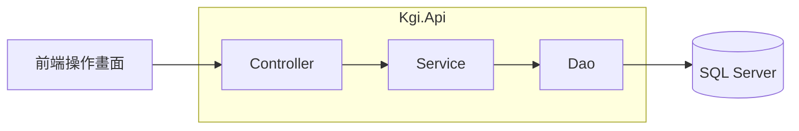

# KGI 證券作業平台

目前提供權證試算，功能與 API 說明請見 [Q1](_Doc/Q1.md)。

## 系統架構



`WarrantService` 負責輸入正規化、驗證、金融計算、流程與 DTO／UTC 格式化；`WarrantDao` 負責 Dapper 參數、SQL 執行、POCO 映射及連線生命週期。SQL 集中在 `WarrantSql`，`SqlConnectionFactory` 只建立連線，維持單一 API 專案。

## 使用方式

需要 .NET 10、Node.js 與 SQL Server。Node.js 與 Orval 的版本及相容需求以 [Kgi.Web/package.json](Kgi.Web/package.json) 為準。以下指令皆在專案根目錄執行。

1. 準備可連線的 SQL Server 執行個體。
2. 首次使用先建立 `KGI` 資料庫，在該資料庫依序執行[建表](Kgi.Tests/Database/Scripts/InitTestDb/DbScript/BuildInitDbScript.sql)、[索引](Kgi.Tests/Database/Scripts/InitTestDb/DbScript/BuildIndexScript.sql)、[預設資料](Kgi.Tests/Database/Scripts/InitTestDb/Preload.sql)。建表會清除既有資料。
3. 依環境設定連線，替換以下範例的資料庫主機、連接埠、帳號與密碼，並依資料庫憑證設定調整連線選項：

```powershell
dotnet user-secrets set 'ConnectionStrings:Kgi' 'Server=<資料庫主機>,<連接埠>;Database=KGI;User Id=<資料庫帳號>;Password="<資料庫密碼>";Encrypt=True;TrustServerCertificate=<true或false>;' --project Kgi.Api
```

4. 在兩個終端機分別啟動後端與前端：

```powershell
# 後端
dotnet run --project Kgi.Api
```

```powershell
# 前端
npm --prefix Kgi.Web ci
npm --prefix Kgi.Web run dev
```

開啟[操作畫面](http://127.0.0.1:5173)，或使用 [Swagger](http://127.0.0.1:5141/swagger) 試呼叫 API。

## API 產碼

更新後端契約與前端型別／Axios 函式：

```powershell
npm --prefix Kgi.Web run api:update
```

只依現有契約重產前端時，執行 `npm --prefix Kgi.Web run api:generate`。契約位於 `Kgi.Api/openapi/Kgi.Api.json`，生成檔位於 `Kgi.Web/src/api/generated/`，兩者一併版控，生成檔不可手改。

產碼使用獨立的 `output/openapi-api` 建置目錄，不必停止正在執行的 API，也不讀寫資料庫；修改 API 本身後仍需重新啟動服務。Axios 的 `VITE_API_BASE_URL` 改為服務根路徑 `/` 或服務根網址，生成路徑已包含 `/api`。

資料庫維護採 DB First：SQL 腳本 → 資料庫 → Dapper SQL／POCO／DAO → Service／DTO → OpenAPI／Orval。後端 DAO 與測試統一使用 Dapper、`Microsoft.Data.SqlClient` 與明確參數化 SQL；`Data/Entities/` 保留純 C# 資料模型，SQL 集中在各功能的 `*Sql.cs`，不使用 Scaffold 產生模型。
