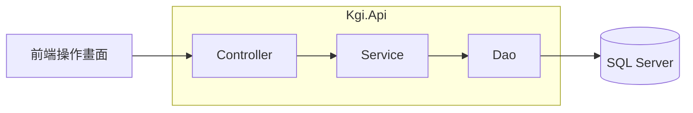

# KGI 證券作業平台

目前提供[權證試算（Q1）](_Doc/Q1.md)、[借券維持率監控（Q2）](_Doc/Q2.md)與[股務代理作業（Q4）](_Doc/Q4.md)。功能可由左側選單切換。

## 系統架構



`WarrantService` 負責輸入正規化、驗證、金融計算、流程與 DTO／UTC 格式化；`WarrantDao` 負責 Dapper 參數、SQL 執行、POCO 映射及連線生命週期。SQL 集中在 `WarrantSql`，`SqlConnectionFactory` 只建立連線，維持單一 API 專案。

Q2 沿用相同分工：`LendingService` 負責 CSV 匯入驗證與流程，`LendingDao` 負責交易式批次寫入；維持率依題目要求，由 `LendingSql` 使用 SQL JOIN 一次計算全部合約。前端 CSV 預覽使用 Papa Parse，正式匯入由後端 CsvHelper 完整解析。

Q4 的 `StockAffairsService` 負責股權異動驗證、精確股利計算與基準日判斷；`StockAffairsDao` 在交易鎖內呼叫功能專用計算，再原子寫入名簿、稽核或批次明細。通知及發放均為模擬，基準日及股票畸零股的示範規則見 [Q4](_Doc/Q4.md)。

## 使用方式

需要 .NET 10、Node.js 24 LTS 與 SQL Server。Node.js 主要版本由 [.nvmrc](.nvmrc) 指定，使用 nvm 時可執行 `nvm install` 與 `nvm use` 切換；Node.js 與 Orval 的版本需求以 [Kgi.Web/package.json](Kgi.Web/package.json) 為準，實際套件版本由 lockfile 固定。以下指令皆在專案根目錄執行。

1. 準備可連線的 SQL Server 執行個體。
2. 首次使用先建立 `KGI` 資料庫，在該資料庫依序執行[建表](Kgi.Tests/Database/Scripts/InitTestDb/DbScript/BuildInitDbScript.sql)、[索引](Kgi.Tests/Database/Scripts/InitTestDb/DbScript/BuildIndexScript.sql)、[預設資料](Kgi.Tests/Database/Scripts/InitTestDb/Preload.sql)。建表會清除既有資料。
3. 依環境設定連線，替換以下範例的資料庫主機、連接埠、帳號與密碼，並依資料庫憑證設定調整連線選項：

```powershell
dotnet user-secrets set 'ConnectionStrings:Kgi' 'Server=<資料庫主機>,<連接埠>;Database=KGI;User Id=<資料庫帳號>;Password="<資料庫密碼>";Encrypt=True;TrustServerCertificate=<true或false>;' --project Kgi.Api
```

4. 在兩個終端機分別啟動後端與前端：

```powershell
# 後端
dotnet run --project Kgi.Api
```

```powershell
# 前端
npm --prefix Kgi.Web ci
npm --prefix Kgi.Web run dev
```

開啟[操作畫面](http://127.0.0.1:5173)，或使用 [Swagger](http://127.0.0.1:5141/swagger) 試呼叫 API。

### 重建 KGI 並驗證真實功能

本版本只有一個 `KGI`；應用程式、重建與測試均使用前述 User Secrets 或環境變數 `ConnectionStrings__Kgi` 所指定的同一組連線。測試總管可單獨執行 `Kgi.Tests.Database.RebuildDbTests.RebuildDb`，也可執行完整 API／資料庫測試。

重建會清除 `KGI` 的 Q1、Q2、Q4 資料，依序執行建表、索引與預設資料腳本，再核對固定數量與控制總額。Q1 為 800 筆權證、Q2 為 1,000 筆合約；Q4 為 3 間公司、300 位股東、506 筆名簿及 1,000 筆快照明細，保留一筆示範歷史過戶，通知及股利明細為空。執行期間應暫停其他寫入，避免與共用資料庫的操作互相影響。

```powershell
$env:KGI_ALLOW_DB_REBUILD = '1'
dotnet test Kgi.Tests/Kgi.Tests.csproj --filter 'FullyQualifiedName=Kgi.Tests.Database.RebuildDbTests.RebuildDb'

# 全套測試會透過真實 HTTP 測試主機與 SQL Server 驗證功能。
dotnet test Kgi.Tests/Kgi.Tests.csproj
```

重建工具只接受資料庫名稱 `KGI`，不會改寫連線中的資料庫名稱；清表前另以實際連線核對 `DB_NAME()`。一般 DB/API 測試透過共用 fixture 在開始前重建同一個 `KGI`；單獨執行 `RebuildDb` 時只重建一次。未設定 `KGI_ALLOW_DB_REBUILD=1` 或連線時，資料庫測試會跳過；完整驗收必須確認零跳過。

### 已有 Q1 資料時加入 Q2

在既有 `KGI` 資料庫依序執行 [Q2 增量建表](Kgi.Tests/Database/Scripts/InitTestDb/DbScript/AddQ2Lending.sql)、[Q4 增量建表](Kgi.Tests/Database/Scripts/InitTestDb/DbScript/AddQ4StockAffairs.sql)及[預設資料](Kgi.Tests/Database/Scripts/InitTestDb/Preload.sql)。預設資料涵蓋全部功能，因此須先備齊 Q2、Q4 資料表。增量腳本保留既有資料；不要對既有資料執行全量建表腳本。

開啟[借券維持率監控](http://127.0.0.1:5173/lending)，選取[行情 CSV 範例](_Doc/examples/Market_Price.csv)，可先按「查看預覽」確認前十筆，再按「確認匯入」。完整規則與人工檢查項目見 [Q2](_Doc/Q2.md)。API 啟動與契約產碼不會自動套用資料庫腳本。

### 已有 Q1 與 Q2 資料時加入 Q4

在既有 `KGI` 資料庫依序執行 [Q4 增量建表](Kgi.Tests/Database/Scripts/InitTestDb/DbScript/AddQ4StockAffairs.sql)及[預設資料](Kgi.Tests/Database/Scripts/InitTestDb/Preload.sql)，再重新啟動 API。Q4 初次預載在單一交易內加入三間公司與固定資料；三間公司均已存在時跳過 Q4 預載，不重置已操作名簿、通知或股利狀態。若只存在部分示範公司會明確拒絕，避免混入不完整基準。

開啟[股務代理作業](http://127.0.0.1:5173/stock-affairs)，可切換三間示範公司。丙公司提供容易核算的過戶／質權、歷史快照及股利案例；現金股利正確總額為 `56.64` 元，另有總額錯誤與畸零股兩筆預期拒絕批次。資料數量、示範規則及人工驗收見 [Q4](_Doc/Q4.md)。

## API 產碼

更新後端契約與前端型別／Axios 函式：

```powershell
npm --prefix Kgi.Web run api:update
```

只依現有契約重產前端時，執行 `npm --prefix Kgi.Web run api:generate`。契約位於 `Kgi.Api/openapi/Kgi.Api.json`，生成檔位於 `Kgi.Web/src/api/generated/`，兩者一併版控，生成檔不可手改。

產碼使用獨立的 `output/openapi-api` 建置目錄，不必停止正在執行的 API，也不讀寫資料庫；修改 API 本身後仍需重新啟動服務。Axios 的 `VITE_API_BASE_URL` 改為服務根路徑 `/` 或服務根網址，生成路徑已包含 `/api`。

資料庫維護採 DB First：SQL 腳本 → 資料庫 → Dapper SQL／POCO／DAO → Service／DTO → OpenAPI／Orval。後端 DAO 與測試統一使用 Dapper、`Microsoft.Data.SqlClient` 與明確參數化 SQL；`Data/Entities/` 保留純 C# 資料模型，SQL 集中在各功能的 `*Sql.cs`，不使用 Scaffold 產生模型。
