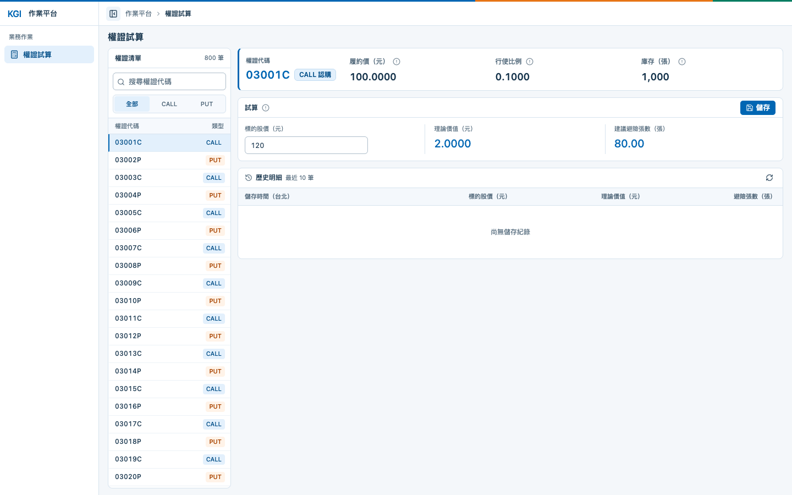

# Q1：權證試算

查詢權證，依標的股價試算理論價值與建議避險張數，並查看最近紀錄。

操作：選擇權證 → 輸入股價 → 查看預覽 → 儲存試算。

前端以人工驗證為準，確認代碼／類型篩選、提示說明、正常與無效股價、儲存後清空及歷史更新。

## PC 版畫面

Chrome 桌面版實際操作畫面（**1440 × 900**、縮放 **100%**）：左側為 800 筆權證清單，右側為基本資料、即時試算與歷史明細區。圖中選擇 `03001C`，輸入股價 `120`。



## API

| 方法與路徑 | 用途 | 成功狀態 |
| --- | --- | --- |
| `GET /api/warrants?keyword=` | 權證清單；可省略關鍵字 | 200 |
| `POST /api/warrants/{id}/preview` | 預覽試算，不儲存 | 200 |
| `POST /api/warrants/{id}/trials` | 重新計算並儲存 | 201 |
| `GET /api/warrants/{id}/trials` | 指定權證最近十筆紀錄 | 200 |

`{id}` 為權證代碼，例如 `03001C`。預覽與儲存使用相同輸入：

```json
{ "marketPrice": "120.0000" }
```

以 `03001C` 預覽時，回應節錄如下：

```json
{ "theoryPrice": "2.0000", "hedgeQty": "80.00" }
```

`theoryPrice` 為理論價值（元），`hedgeQty` 為建議避險張數；儲存後另回傳紀錄編號與 UTC 時間。

股價須大於零、最多四位小數且不超過 `99999999999999.9999`（`DECIMAL(18,4)`）。無效輸入回傳 `400`，查無權證回傳 `404`，並附錯誤說明。

## 合成測試資料

初始化提供 800 筆合成權證，CALL／PUT 各 400 筆。所有代碼、履約價、行使比例與庫存直接列在 `Preload.sql` 的 `VALUES`，可以逐筆閱讀或修改；SQL 執行時不再使用雜湊、亂數公式或多層 CTE。資料包含 799 種履約價、15 種行使比例、738 種庫存數量，不代表真實掛牌權證或券商部位。`03001C`、`03002P` 保留履約價 100、行使比例 0.1、庫存 1000 張，作為固定試算範例。

`Preload.sql` 僅補入缺少的代碼，不覆寫既有主檔或新增試算紀錄。資料多樣性的調整維持題目指定的 CALL／PUT 簡化定價與 Delta 模型。

## 設計理由

### 前端

- 桌面清單與試算並排，搭配搜尋與類型篩選，篩選保留目前選券；手機改為切換顯示，避免擁擠。
- 重點數值集中呈現，公式與欄位說明放在提示中，方便判讀而不占畫面。
- 輸入股價後自動預覽，減少操作；切券或改價立即使舊預覽失效，防止誤判。
- 預覽採防抖、取消舊請求並丟棄過期回應；只有對應目前選券與股價的最新預覽可儲存。
- 儲存中停用選券與股價輸入，避免重複送出或資料混用；成功後清空股價與結果、保留選券並更新歷史，方便連續試算。
- 存檔失敗保留輸入與預覽；歷史讀取失敗獨立顯示，不當成存檔失敗。不自動重試寫入，結果不明時先重新載入歷史確認。

前端維護入口：

| 檔案 | 負責範圍 |
| --- | --- |
| `layouts/AppLayout.vue` | 全站選單、Header、手機抽屜與收合動畫 |
| `features/warrants/WarrantsPage.vue` | 組合清單、基本資料、試算與歷史，處理畫面切換及焦點 |
| `features/warrants/useWarrantWorkspace.ts` | 股價驗證、預覽防抖、請求取消、存檔與歷史查詢狀態 |
| `features/warrants/WarrantList.vue`、`WarrantHistory.vue` | 清單篩選／鍵盤操作，以及歷史表格／台北時間顯示 |
| `components/HelpHint.vue` | 共用浮動說明與鍵盤操作 |
| `api/http.ts`、`api/mutator.ts`、`features/warrants/warrantApi.ts` | 共用 Axios 設定、產碼請求入口與功能轉接 |

外框與 Q1 頁面的桌面／手機判斷使用 VueUse `useMediaQuery`，斷點與 Tailwind 的 `md`（768px）一致。

手寫程式以繁中註解標示責任、狀態分群及畫面區塊；`api/generated/` 的型別與 API 函式由 Orval 維護，應調整後端契約或產碼設定後重新產生，不直接修改生成檔。

### 後端

- 預覽不儲存，避免每次調整股價都產生紀錄。
- 儲存時由後端重算，確保結果一致；價格以字串傳送，避免精度誤差。
- 使用題目簡化 CALL／PUT 模型：理論價值為非負價差乘行使比例，避險張數為庫存張數乘行使比例與 Delta；價內／價平／價外的 Delta 均為正值 `0.8`／`0.5`／`0.2`。
- 計算使用 `decimal`；理論價值不得超過 `99999999999999.9999`，避險張數不得超過 `9999999999999999.99`，分別對應 `DECIMAL(18,4)`／`DECIMAL(18,2)`。
- 理論價值與避險張數以 `MidpointRounding.AwayFromZero` 四捨五入至四位／兩位；API 的價格與行使比例固定四位小數、避險張數固定兩位，皆以不受地區影響的字串輸出。
- 時間以 UTC 儲存及傳輸，前端以台北時間顯示。
- 歷史只取最近十筆，依建立時間倒序，同時間再依 `LogId` 倒序，維持穩定排序。

後端採 Controller → Service → Dao → DB：`WarrantService.cs` 負責輸入正規化、驗證、金融計算、流程及 DTO／UTC 格式化，`WarrantDao.cs` 負責 Dapper 參數、SQL 執行、POCO 映射與連線開啟／釋放；`WarrantSql.cs` 集中參數化 SQL，`Data/SqlConnectionFactory.cs` 只建立連線，`Data/Entities/` 保留純 C# 資料模型。結構調整先維護 SQL 腳本，再同步 SQL／POCO／DAO 與 API 契約；詳細規範見 [後端開發 skill](../.agents/skills/kgi-backend/SKILL.md)。

[返回使用說明](../README.md)
