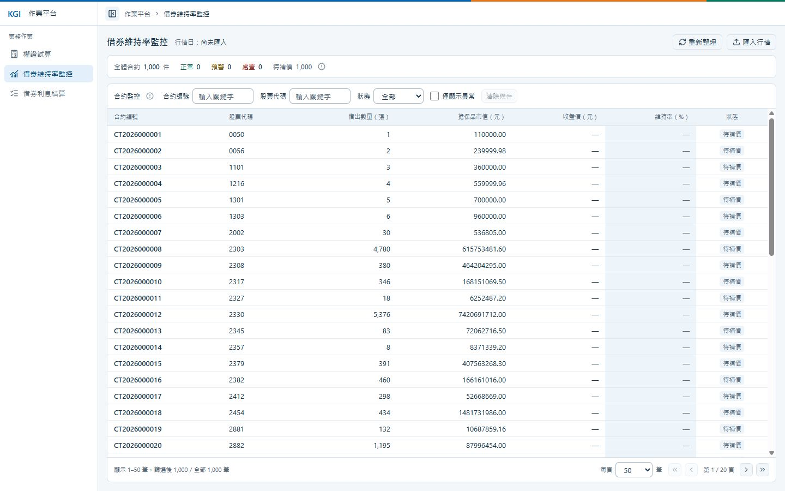

# Q2：借券維持率監控

依匯入行情計算借券合約維持率，頁面入口為 `/lending`。

## 操作

1. 按「匯入行情」選取 CSV，可選擇「查看預覽」檢視前十筆。
2. 按「確認匯入」，先在確認視窗核對檔名及同日替換影響，再確認寫入；成功後更新行情日、統計及合約清單，同日重傳會替換該日行情。取消確認會保留選檔。
3. 可依合約編號、股票代碼及狀態篩選，或開啟「僅顯示異常」。
4. 按「重置行情」並確認，清除所有日期的行情，回到「尚未匯入」與待補價；合約、權證及試算紀錄保留。

「重新整理」只重新讀取目前行情與合約，不匯入新行情，也不清除資料。

## PC 版畫面

桌面版（1440 × 900），尚未匯入行情的既有版本截圖；目前工具列另有「重置行情」。



## CSV 格式

範例：[一般行情](examples/Market_Price.csv)、[上漲行情](examples/Market_Price_Up.csv)、[下跌行情](examples/Market_Price_Down.csv)。

```csv
Stock_ID,Closing_Price,Trade_Date
2330,815.00,20261028
```

- UTF-8、單檔不超過 2 MiB；表頭須與上例一致。
- 每份檔案只接受一個交易日，日期格式為 `yyyyMMdd`。
- 收盤價須大於零、最多四位小數；股票不可重複，且須涵蓋全部合約標的。
- 驗證失敗時整批拒絕，不寫入部分資料。預覽不代表正式匯入成功。

## 維持率

維持率（%）＝擔保品總市值 ÷（借出張數 × 1000 × 收盤價）× 100。

| 狀態 | 條件 |
| --- | --- |
| 處置 | 小於 120% |
| 預警 | 大於等於 120%、小於 140% |
| 正常 | 大於等於 140% |
| 待補價 | 尚無行情，無法計算 |

狀態依未四捨五入的數值判斷，維持率顯示至兩位小數。

## API

| 方法與路徑 | 用途 | 成功狀態 |
| --- | --- | --- |
| `GET /api/lending/monitor?tradeDate=` | 查詢監控，省略日期時取最新日 | 200 |
| `POST /api/lending/market-prices/import` | 以 multipart 的 `file` 欄位匯入 CSV | 200 |
| `DELETE /api/lending/market-prices` | 重置全部行情 | 204 |

查詢日期格式為 `yyyy-MM-dd`；尚未匯入時，`tradeDate` 為 null。

## 設計架構

- 前端：Vue 元件呈現匯入區與合約表格；`useLendingMonitor` 管理匯入、重置及監控狀態。
- 後端：`Controller → LendingService → LendingDao → KGI`，Service 驗證 CSV 與操作流程，Dao 透過 Dapper 以交易整批寫入行情。
- 資料：合約與行情分表保存，SQL 透過一次 JOIN 計算全部合約的維持率，前端只顯示結果。

[返回 README](../README.md)
