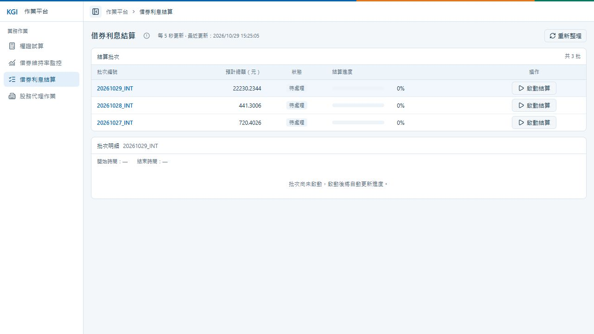
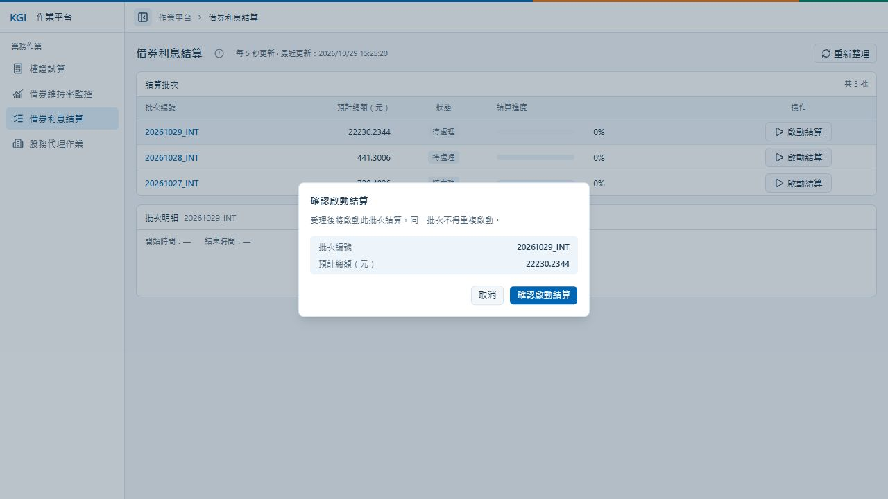

# Q3：借券利息結算與監控

依批次計算借券單日利息並監控結果，頁面入口為 `/interest`。功能隨 API 預設啟用，批次由使用者手動啟動。

## 操作

1. 開啟「借券利息結算」，選取批次查看預計總額、狀態與明細。
2. 按「啟動結算」，核對批次與預計總額後確認；取消不會啟動。
3. 頁面每五秒更新。成功顯示 100%、實算總額與明細；失敗顯示錯誤原因。

離開頁面不會取消結算，重新開啟可接續監控。更新失敗保留舊資料；啟動結果不明時先查狀態，不自動重送。

## PC 版畫面

## 計息規則

單日利息＝本金 × 年利率 ÷ 365，使用合成示範來源；3% 年利率保存為 `0.03`。

- 使用 `decimal`，逐筆四捨五入至四位小數後加總。
- 實算總額與預計總額的絕對差異 **大於 0.0001** 時失敗；不覆寫預計總額。
- 明細、總額校驗與成功狀態在同一交易內；失敗回滾全部明細，另存錯誤原因。
- 每處理 200 筆更新進度，提交前最多 95%，成功才到 100%；快速完成時畫面可能直接從 0% 跳到 100%。

## 批次狀態

| 狀態 | 意義 | 可否啟動 |
| --- | --- | --- |
| 0 | 待處理 | 可以 |
| 1 | 已受理／處理中 | 不可以 |
| 2 | 結算成功 | 不可以 |
| 9 | 失敗或程序中斷 | 不可以，需人工處理 |

同批只受理一次。重啟後，尚未開始的已受理批次可續行；已開始但工作者中斷的批次標記失敗，不自動重跑。本版未提供凌晨排程、失敗重試或正式計息來源串接。

## API

| 方法與路徑 | 用途 | 成功狀態 |
| --- | --- | --- |
| `GET /api/interest/batches` | 批次列表與進度 | 200 |
| `GET /api/interest/batches/{id}` | 單批狀態與已提交明細 | 200 |
| `POST /api/interest/batches/{id}/settlement` | 受理結算，不需 request body | 202 |

未成功時實算總額為 null、明細為空。金額為四位小數字串，時間以 UTC 傳輸、台北時間顯示；非待處理批次回傳 `409`，明確停用或資料表未就緒時回傳 `503`。

## 示範資料

| 批次 | 筆數 | 實算總額 | 預計總額 | 預期結果 |
| --- | ---: | ---: | ---: | --- |
| `20261029_INT` | 1,000 | 22230.2344 | 22230.2344 | 成功 |
| `20261028_INT` | 10 | 441.3004 | 441.3006 | 差異 0.0002，整批明細回滾 |
| `20261027_INT` | 5 | 720.4026 | 720.4026 | 成功 |

以上為新初始化資料；重跑預載不重設既有結算結果。

## 設計架構

- 前端：Vue 呈現批次、進度與明細，`useInterestMonitor` 管理輪詢及啟動狀態。
- 後端：`Controller → InterestService → InterestDao → KGI`，Service 計息，Dao 管理 Dapper、交易及批次鎖；背景工作者每兩秒檢查已受理批次。
- 資料：批次、來源快照與成功明細分表保存；進度獨立更新，監控不讀取未提交明細。

[返回 README](../README.md)
