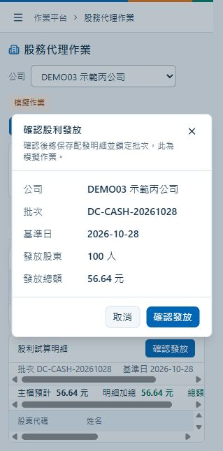

# Q4 股務代理作業與假資料

Q4 在既有平台加入公司總覽、股東名簿、單筆／批次過戶與質權異動、股東會通知模擬，以及現金／股票股利試算與確認。依據為[實作測驗題目四](全端開發工程師實作測驗說明.md#q4)；以下假資料與示範規則由本專案設計。

本版本只使用單一資料庫 `KGI`，應用程式、重建與測試共用同一組 `ConnectionStrings:Kgi`。完整驗收會確切清除並重建 `KGI` 的資料表、索引及假資料，再驗證真實 API、SQL Server 與前端操作。

## 示範規則

- 股數單位為「股」，不是張；可用股數為持股減已質押股數。股東人數只計算正持股者，零股名簿仍可查詢。
- 名簿涵蓋示範公司的全部發行股數；總股數以 BIGINT 聚合。質押比例為質押總股數除以總股數，零總股數時顯示 0.00%。
- 會議基準日固定為會議日前 30 個日曆日，僅為測驗示範規則。以日期精確查找不可變快照，沒有快照時拒絕，不以目前名簿替代。
- 快照只收錄正持股股東，保存姓名、地址、持股與質押。首版只有預載的兩個基準日，不提供任意日期的歷史回算或快照排程。
- 現金股利逐戶使用 decimal，採 MidpointRounding.AwayFromZero 取兩位，再加總與主檔精確對帳，不自動調整主檔或分攤差額。
- 股票股利以持股乘配股率；首版只接受逐戶結果皆為整股的批次，遇畸零股時顯示原因並阻擋確認。Total_Amount 在 CASH 表示元，在 STOCK 表示股，API 明列 TWD／SHARE 單位。
- 通知與股利均為模擬作業，不連接寄信、銀行或集保；股票確認只凍結配發明細，不回寫增資後持股。
- 操作者由後端固定示範身分 DEMO_OPERATOR 記錄，不能由前端任填；正式環境須接登入身分，目前不代表已識別真實使用者。

## 假資料數量與公司分布

所有身分資料、地址與部位均為合成資料。股東使用 SH0001 至 SH0300，身分欄位使用 TEST-ID-0001 等明顯測試字串，地址使用「測試市示範區」。同一股東可以持有不同公司股票，所有名簿操作必須帶公司代碼。

| 項目 | 初始數量 | 說明 |
| --- | ---: | --- |
| 公司 | 3 | DEMO01、DEMO02、DEMO03 |
| 股東主檔 | 300 | SH0001 至 SH0300 |
| 目前名簿 | 506 | 500 筆正持股及 6 筆零持股 |
| 快照主檔 | 6 | 3 公司乘 2 個日期 |
| 快照明細 | 1,000 | 每個日期 500 筆正持股 |
| 歷史異動請求及紀錄 | 各 1 | DEMO03 的固定歷史過戶 |
| 股東會 | 6 | 每公司常會、臨時會各一，初始均未通知 |
| 股利批次 | 8 | 6 筆可成功及 2 筆預期拒絕案例，初始均待處理 |
| 通知及股利明細 | 0 | 操作成功後才新增 |

| 公司 | 名稱 | 正持股股東範圍 | 人數 | 零持股名簿 |
| --- | --- | --- | ---: | --- |
| DEMO01 | 示範甲公司 | SH0001 至 SH0240 | 240 | SH0241、SH0242 |
| DEMO02 | 示範乙公司 | SH0141 至 SH0300 | 160 | SH0001、SH0002 |
| DEMO03 | 示範丙公司 | SH0001 至 SH0100 | 100 | SH0101、SH0102 |

六筆零股名簿的質押都為零，不列入股東人數、快照、通知或股利。不存在的公司與存在但沒有股東的公司分別驗證；空公司由測試另外建立，不增加預載公司數。

### 甲乙公司資料分布

下列公式只用於離線產製固定資料。實際 SQL 必須展開為可逐筆修改的 VALUES，不在執行期使用亂數、雜湊或公式產生部位。

- 甲公司依股東順序 j＝1 至 240，持股為 `(100 + ((137*j + 17*j*j) % 19901)) * 100`。
- 乙公司依股東順序 j＝1 至 160，持股為 `(10 + ((181*j + 23*j*j) % 7991)) * 100`，股東編號為 j＋140。
- 兩公司質押依 j 除以 5 的餘數 0、1、2、3、4，分別採持股的 0%、10%、25%、50%、100%。所有結果皆為整數。
- 甲公司有 240 種持股數，乙公司有 159 種；乙公司兩戶同為 513,600 股但質押不同，供排序及辨識驗證。

| 控制總額 | DEMO01 | DEMO02 | DEMO03 |
| --- | ---: | ---: | ---: |
| 正持股股東 | 240 | 160 | 100 |
| 總股數 | 235,257,700 | 62,018,900 | 11,322 |
| 質押股數 | 90,214,835 | 22,935,495 | 1,366 |
| 可用股數 | 145,042,865 | 39,083,405 | 9,956 |
| 顯示質押比例 | 38.35% | 36.98% | 12.07% |

### 丙公司固定核算案例

| 股東 | 9月30日持股 | 10月28日及目前持股 | 質押 | 用途 |
| --- | ---: | ---: | ---: | --- |
| SH0001 | 1 | 1 | 0 | 最小正股數、股利中點捨入 |
| SH0002 | 2 | 2 | 0 | 偶數股與整股配發 |
| SH0003 | 3 | 3 | 1 | 可用股數為 2 |
| SH0004 | 5 | 5 | 5 | 全額質押、可撤銷質權 |
| SH0005 | 10 | 10 | 0 | 可完整過戶成零股 |
| SH0006 | 100 | 99 | 9 | 歷史快照與目前名簿差異 |
| SH0007 | 100 | 100 | 100 | 全額質押 |
| SH0008 | 100 | 101 | 1 | 歷史過戶受讓人 |
| SH0009 | 1,000 | 1,000 | 250 | 部分質押 |
| SH0010 | 1,001 | 1,001 | 1,000 | 僅一股可用 |
| SH0011 至 SH0100 | 各 100 | 各 100 | 0 | 固定核算樣本 |

2026-10-15 預載一筆 DEMO03 的 SH0006 轉給 SH0008 一股歷史過戶，並保存異動前後值。目前名簿直接初始化為 10 月 28 日狀態，不再重播歷史紀錄。

## 基準日與股東會

快照日期為 2026-09-30 與 2026-10-28，每日三家公司各一份。甲乙公司的兩期部位相同；丙公司依上述一股過戶呈現差異，兩日期的股東數、股數及質押總額都相同。

每公司各有 2026-10-30 的 AGM 與 2026-11-27 的 EGM，分別對應前述兩個基準日。Meeting_ID 採 M-A-20261030 等固定代碼，A／B／C 分別對應三間公司。通知名單應為甲 240、乙 160、丙 100 人；歷史會議的 SH0006／SH0008 持股必須仍為 100／100。

## 股利批次與精確預期結果

| Batch_ID | 公司 | 基準日 | 類型 | 每股配發 | 主檔總額 | 預期 |
| --- | --- | --- | --- | ---: | ---: | --- |
| DA-CASH-20260930 | DEMO01 | 2026-09-30 | CASH | 1.2500 | 294,072,125.00 元 | 成功，240 筆 |
| DA-STOCK-20260930 | DEMO01 | 2026-09-30 | STOCK | 0.1000 | 23,525,770.00 股 | 成功，240 筆 |
| DB-CASH-20261028 | DEMO02 | 2026-10-28 | CASH | 0.7500 | 46,514,175.00 元 | 成功，160 筆 |
| DB-STOCK-20261028 | DEMO02 | 2026-10-28 | STOCK | 0.0500 | 3,100,945.00 股 | 成功，160 筆 |
| DC-CASH-20261028 | DEMO03 | 2026-10-28 | CASH | 0.0050 | 56.64 元 | 成功，100 筆 |
| DC-STOCK-20260930 | DEMO03 | 2026-09-30 | STOCK | 1.0000 | 11,322.00 股 | 成功，100 筆 |
| DC-CASH-BADTOTAL | DEMO03 | 2026-10-28 | CASH | 0.0050 | 56.61 元 | 拒絕，明細應為 56.64 |
| DC-STOCK-FRACTION | DEMO03 | 2026-10-28 | STOCK | 0.5000 | 5,661.00 股 | 拒絕，個別股東產生非整股 |

丙公司以 0.0050 元逐戶計算，9 月 30 日應為 56.63 元，10 月 28 日為 56.64 元；直接用 11,322 股乘單價只會得到 56.61 元。這組資料同時驗證歷史快照與逐戶捨入，不得用總股數乘單價代替明細加總。

兩筆預期拒絕的批次是可見的示範案例，資料型態與外鍵仍合法。失敗後狀態保持 0，不能留下部分股利明細。

## 資料結構與交易

保留原題 Shareholder_Master、Shareholding_Register、Share_Transfer_Log、Shareholders_Meeting、Dividend_Batch 五張表。

| 補充資料表 | 主要欄位與用途 |
| --- | --- |
| Company_Master | Company_Code、Company_Name，供切換公司與識別空公司 |
| Shareholding_Snapshot | Snapshot_ID、Company_Code、Record_Date、Created_Time；公司及日期唯一 |
| Shareholding_Snapshot_Detail | Snapshot_ID、Shareholder_ID、Shareholder_Name、Address、Share_Qty、Pledge_Qty；快照及股東為複合主鍵 |
| Share_Operation_Request | Request_ID、Company_Code、Payload_Hash、Operator_ID、Created_Time；同請求重送只取得既有結果 |
| Meeting_Notice_Detail | Meeting_ID、Shareholder_ID、Shareholder_Name、Address、Share_Qty、Sent_Time、Operator_ID；會議及股東唯一 |
| Dividend_Detail | Batch_ID、Shareholder_ID、Shareholder_Name、Share_Qty、Dividend_Per_Share、Dividend_Value；批次及股東唯一 |

Share_Transfer_Log 增加 Request_ID、Item_No、Operator_ID，並保存出讓人及受讓人的持股／質押異動前後值；質權操作的出讓人與受讓人均為股東本人。Meeting 與 Dividend_Batch 增加 Snapshot_ID；股利批次另記 Completed_Time、Operator_ID。主外鍵、非負股數、質押不超過持股、合法類型及狀態由 SQL 約束保護，表與欄位均寫繁中 MS_Description。

Service 負責驗證、計算及 DTO，Dao 負責 Dapper、連線與交易，SQL 集中功能檔案。同公司股權異動依序取得交易鎖，依輸入順序處理最多 100 筆；名簿、請求及所有紀錄同交易成功。相同 Request_ID 與相同內容回傳既有結果，不同內容回傳 409。股利以 Batch_ID 鎖定，明細與完成旗標同交易提交；重送回傳已完成結果。

## API 與畫面入口

功能放在 Kgi.Api/Features/StockAffairs 與 Kgi.Web/src/features/stock-affairs，畫面路由為 /stock-affairs。沿用 ProblemDetails、UTC 時間與 OpenAPI／Orval；價格、配發率、總額及聚合股數使用精確字串。

以下路徑共同以 /api/stock-affairs 開頭：

| 方法與路徑 | 用途 |
| --- | --- |
| GET /companies | 公司清單及總覽統計 |
| GET /{companyCode}/register | 名簿與可選的全部股東主檔 |
| GET /{companyCode}/transfers | 股權異動歷史 |
| POST /{companyCode}/transfers | 單筆或批次過戶／質權 |
| GET /{companyCode}/meetings | 會議列表 |
| GET /{companyCode}/meetings/{meetingId}/notices | 基準日通知預覽或已寄發明細 |
| POST /{companyCode}/meetings/{meetingId}/notices | 模擬產生並寄發通知 |
| GET /{companyCode}/dividends | 股利批次列表 |
| POST /{companyCode}/dividends/{batchId}/preview | 逐戶試算、精確總額及可確認狀態 |
| POST /{companyCode}/dividends/{batchId}/confirm | 重新驗證並模擬發放 |

股權異動輸入包含 requestId 與 items；每筆包含 transferType（TRANSFER／PLEDGE／UNPLEDGE）、fromShareholder、toShareholder（質權時可省略）、quantity。名簿只回傳遮罩身分欄位，不傳完整 ID_No。

畫面以公司切換及單列統計為頂部，下方切換名簿、股東會、股利與異動紀錄。工作區固定為可用視窗高度，只有表格內部捲動，表頭使用不透明底色。成功結果以浮動 Toast 提示，載入錯誤提供浮動重試，不插入會擠壓表格的常駐訊息。

工具列或名簿的「股權異動」會開啟 Dialog，先編輯單筆／批次內容，再核對摘要，只有「確認送出」會發送請求。通知與股利同樣先開啟確認 Dialog，顯示公司、會議／批次、基準日、人數與金額或股數；取消不寫入，錯誤保留在彈窗。送出中禁止重複提交或關閉，成功後才清空異動草稿。

Dialog 使用 150ms 淡入縮放與淡出動畫，頁籤在原有高度內轉場；系統設定減少動態效果時停用動畫。側欄維持既有收合動效。時間值固定轉換為 Asia/Taipei 顯示，欄名只標示操作時間或通知時間；股數欄僅提示「輸入股數」，無效內容在送出時阻擋。切換公司時取消舊查詢並丟棄過期回應，寫入成功與刷新失敗分別處理。

## 製作順序與驗收

1. 完成 AddQ4StockAffairs.sql、全量建表、索引與固定 VALUES 假資料；既有 KGI 使用增量腳本，保留 Q1／Q2。
2. 完成公司、名簿、歷史查詢及單筆／批次交易；驗證股數不足、全額質押、超額撤銷、受讓人原無名簿、跨公司、整批回滾及重送。
3. 完成會議通知；驗證 30 日示範算法、固定收件人數、歷史持股、缺快照拒絕及重送。
4. 完成現金／股票股利；驗證八筆固定案例、兩日期捨入差異、空名簿、溢位、併發確認及完成後鎖定。
5. 完成前端與 OpenAPI／Orval 產碼，保留桌面、手機與鍵盤操作；前端功能由人工驗證。
6. 重建共用的 KGI 並執行後端及資料庫測試，確認資料庫測試實際執行，不把跳過當通過。重建檢查保留 Q1 800 筆與 Q2 1,000 筆，另核對本文件所有 Q4 初始數量與控制總額。

預載資料須能安全重跑：不覆寫已操作名簿、不清除異動、不重建既有快照、不重置通知或發放狀態。Q4 初次初始化在單一交易內完成；測試重建後還原本文件基準，應用程式啟動及 API 產碼均不自動套用 SQL。

## 已完成驗證

2026-10-29 以一般 PowerShell 在 sandbox 外執行，資料庫目標精確限定為應用程式使用的同一個 KGI：

| 驗證 | 結果 |
| --- | --- |
| dotnet test Kgi.Tests/Kgi.Tests.csproj | 77 項通過，0 失敗、0 跳過，包含既有 Q1／Q2、Q4 與單一資料庫名稱防護 |
| 單獨執行 RebuildDbTests.RebuildDb | 通過，核對固定筆數與控制總額；全套測試後再次重建還原基準 |
| npm --prefix Kgi.Web run api:generate | OpenAPI／Orval 契約重產成功 |
| 初版 npm --prefix Kgi.Web run build | 使用 Node.js 24.19.0，型別檢查與正式編譯通過；本次 Dialog 與固定版面修正以實際畫面驗證 |
| 既有資料庫重跑 AddQ4StockAffairs.sql | 資料及索引均保持不變 |
| 暫存持股、已通知及已發放後重跑 Preload.sql | 全部操作狀態與明細保留，最後回滾並核對還原 |
| 不同批次、相同請求、最後一股的併發操作 | 無重複發放、無重複過戶，超額異動被拒絕 |
| 瀏覽器經真實前端與 API 操作 KGI | 過戶、批次質權設定／撤銷、超額拒絕、歷史通知、現金及股票確認均通過 |
| 畫面操作後直接 SELECT 查核 KGI | 26 項符合預期，含失敗批次整批回滾、通知 100 筆、現金 56.64 元及股票 11,322 股 |
| 股利異常案例的前端確認限制 | 主檔總額不符與個別畸零股皆顯示原因並停用確認 |

實際畫面驗證透過此 worktree 的前端與 API，未以模擬 API 回應替代；通知與發放的外部作業仍依示範規則模擬，名簿、通知及股利明細均實際寫入 KGI。驗證後再次重建同一個 KGI，還原為本文件的初始假資料。

畫面修正後已另外核對 Dialog 開關、摘要確認、取消不寫入、返回焦點、股數阻擋及真實 API 驗證錯誤；錯誤出現前後主工作區高度均維持不變，表頭為不透明底色。Dialog 動畫為 150ms，手機側欄展開動畫為 200ms。本次畫面調整未重建資料庫，未執行 build 或前端自動測試。以下為目前的股利確認 Dialog：

## 畫面驗收步驟

1. 桌面與手機選單可切換 Q1、Q2、Q4；股務預設顯示甲公司，三間公司統計符合控制總額。
2. 丙公司名簿為 102 筆，切換僅正持股後為 100 筆；搜尋、排序、分頁不改變公司統計。完整身分欄位不出現在 API 或畫面。
3. 工具列或名簿操作開啟股權異動 Dialog；先編輯、再核對摘要，最終確認才提交。確認單筆／多列、股數驗證、新增／刪除列與鍵盤操作；SH0003 可過戶 2 股、不能過戶 3 股，SH0004 全額質押，撤銷前不能過戶。批次後段失敗時前段不得改變，驗證錯誤不改變主工作區高度。
4. 取消、Escape 或遮罩關閉保留草稿，重開可繼續；切換公司清空前一公司的表單與預覽。送出中鎖定公司、表單與關閉操作，失敗保留內容，同內容重送沿用原請求編號，成功才清空。Dialog 有進出動畫，關閉後返回原按鈕焦點。
5. 預覽丙公司 10 月 30 日會議，SH0006、SH0008 應各為 100 股；寄發前先出現確認 Dialog，取消後仍未通知，確認後顯示凍結的收件時間。
6. DC-CASH-20261028 預覽應為 56.64 元，SH0001 應為 0.01 元；確認 Dialog 列出公司、批次、人數及精確總額，取消不寫入，確認後鎖定且明細仍可查看。股票批次使用股數單位。
7. DC-CASH-BADTOTAL 顯示 56.64 與 56.61 的差額原因；DC-STOCK-FRACTION 顯示個別非整股原因，兩者均不能確認。
8. 快速切公司或明細，不得出現上一筆回應；寫入成功及刷新失敗以浮動提示區分，主工作區不增加額外訊息列。頁籤切換有轉場，表頭捲動時不透出下方資料。
9. 手機表格及 Dialog 多列表單可以橫向捲動；工作區無額外的整頁垂直捲軸，表格在分配高度內捲動，分頁與彈窗操作鈕維持可見。

[返回使用說明](../README.md)
