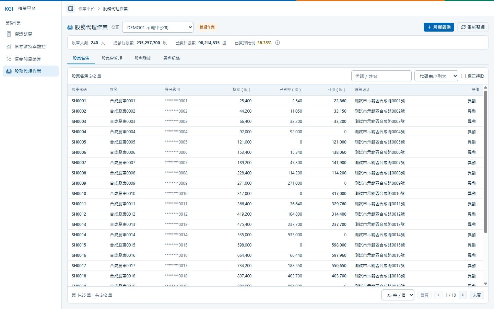

# Q4：股務代理作業

管理公司股東名簿、股權異動、股東會通知及股利發放，頁面入口為 `/stock-affairs`。使用單一資料庫 `KGI`，預載三間公司的合成示範資料。

## 操作

1. 選擇公司，查看股東人數、總股數及質押比例；名簿可搜尋、排序與篩選正持股股東。
2. 按「股權異動」，輸入單筆或批次過戶、質權設定／撤銷，核對摘要後確認送出；結果可在「異動紀錄」查詢。
3. 在「股東會管理」預覽基準日通知名單，確認後模擬寄發。
4. 在「股利發放」預覽現金或股票股利，核對明細與總額後確認發放。

所有寫入操作皆須經確認視窗；取消不寫入。「重新整理」只重新讀取資料。

## PC 版畫面

## 主要規則

- 股數單位為「股」，可用股數＝持股－已質押股數；股東人數只計算正持股者。
- 股權異動每批最多 100 筆，任一筆失敗則整批不寫入；相同請求重送不會重複異動。
- 股東會基準日為會議日前 30 個日曆日，屬示範規則；通知與股利皆使用基準日快照，缺少快照時拒絕處理。
- 現金股利逐戶四捨五入至兩位小數後加總，須與批次總額一致；股票股利須逐戶為整股，否則不能確認。
- 通知與股利確認後保存明細並鎖定，重送不會重複處理；總額不符或畸零股的示範批次會顯示原因並阻擋確認。
- 通知及發放皆為模擬，未串接寄信、銀行或集保；股票股利確認只保存配發明細，不更新持股。

## API

共同前綴為 `/api/stock-affairs`，`{companyCode}` 為公司代碼。

| 方法與路徑 | 用途 |
| --- | --- |
| `GET /companies` | 公司清單與統計 |
| `GET /{companyCode}/register` | 股東名簿 |
| `GET /{companyCode}/transfers` | 股權異動紀錄 |
| `POST /{companyCode}/transfers` | 單筆或批次股權異動 |
| `GET /{companyCode}/meetings` | 股東會清單 |
| `GET /{companyCode}/meetings/{meetingId}/notices` | 通知預覽或已寄發明細 |
| `POST /{companyCode}/meetings/{meetingId}/notices` | 模擬寄發通知 |
| `GET /{companyCode}/dividends` | 股利批次清單 |
| `POST /{companyCode}/dividends/{batchId}/preview` | 試算股利，不寫入資料 |
| `POST /{companyCode}/dividends/{batchId}/confirm` | 確認模擬發放 |

## 設計架構

- 前端：Vue 元件呈現名簿、股東會、股利與異動紀錄；`useStockAffairsWorkspace` 管理公司切換、查詢及確認操作。
- 後端：`Controller → StockAffairsService → StockAffairsDao → KGI`，Service 負責驗證與計算，Dao 透過 Dapper 存取資料及管理交易。
- 資料：目前名簿與基準日快照分開保存；異動紀錄、通知及股利明細以交易寫入，避免部分成功或重複處理。

[返回 README](../README.md)
